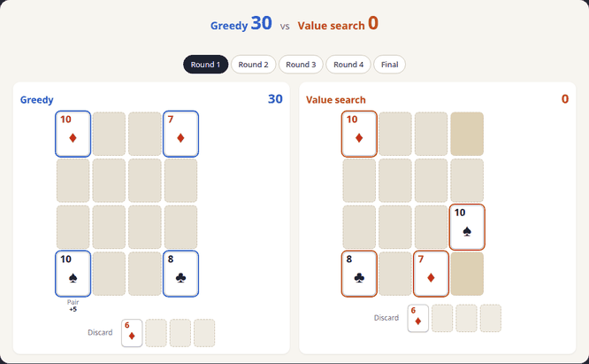

# PileupPokerBot

Agents that learn to play [Pile-Up Poker](https://www.puzzmo.com/game/pile-up-poker), a single-player card game on Puzzmo, and a Chrome extension, **PokerGrid 4x4**, that lets you play against the best of them on the website or shows its suggestions while you play.



*The greedy baseline (left) and the value search bot (right) on the same four hands. Greedy leads after round 2; value search sets up straights and a scoring discard pile and wins 6,990 to 3,275.*

Everything is written in JAX: a batched game environment, a greedy baseline, Monte Carlo search, afterstate TD learning, an AlphaZero-style agent with [mctx](https://github.com/google-deepmind/mctx), PPO with an attention network, and a round-level value search. The best agent, a value search over whole rounds guided by a learned value network, averages about **6,900** points per game, versus 3,103 for the greedy baseline and 370 for random play. It runs in the browser in about 0.16 s per game.

The JAX environment is a port of the original Python/Gymnasium environment that follows the method of [Automatic Generation of High-Performance RL Environments](https://arxiv.org/abs/2603.12145) (Karten, Appapogu, Jin, 2026). It plays the same games (identical observations, rewards and scores in 1000 test games, and trained agents score exactly the same in both) and simulates about **71M steps/s** on one RTX 3090, **2,295x** the original environment in one process. PPO training runs **9x** faster end to end. See [docs/jax-port.md](docs/jax-port.md).

This is a personal project. It is not affiliated with or endorsed by Puzzmo. The extension never plays for you.

## The game in short

- 36 cards (ranks 6 to A, 4 suits), a 4x4 board, 4 rounds.
- Each round you get 5 cards, place 4 of them on empty cells, and the 5th goes to the discard pile. Cards never move.
- 10 poker hands score: 4 rows, 4 columns, the 4 corners (x2), and the 4-card discard pile (x3, only if the first 9 hands all score).
- Hand values: pair 5, two pairs 60, flush 80, three of a kind 125, straight 180, four of a kind 325, straight flush 450.
- The total is multiplied by x2 to x6, depending on how many of the 10 hands score (x6 for all 10).

Full rules, the environments and how the scoring was checked against the real game: [docs/environment.md](docs/environment.md).

## Results

Every agent plays the same 1000 decks (`compare_agents.py --num-decks 1000 --seed 0`). Mean final score ± standard error. Training times are on one RTX 3090 that was shared by several runs.

| agent | training | mean ± SE |
|---|---|---|
| [value search](docs/algorithm.md) (the bot in the extension) | uses the afterstate MLP and a 128-wide network | **6897 ± 72** \* |
| [PPO](docs/ppo.md), attention network | 200M + 60M steps, 3.9 h | 6294 ± 67 |
| [afterstate TD](docs/afterstate-td.md), MLP | 10.2M games, 55 min | 6133 ± 72 |
| [Monte Carlo search](docs/mc-search.md), greedy rollouts | – | 4973 ± 57 |
| [AlphaZero-style](docs/alphazero.md), 64 simulations | 909k games, 2.6 h | 4551 ± 56 |
| [greedy](docs/greedy.md) | – | 3103 ± 42 |
| random | – | 370 ± 14 |

The best version of each method is shown.

\* The cheap version of value search (beam search, successive halving, a 128-wide network for the moves inside the lookahead), measured with `benchmarks/fast_search.py` (JAX, one search seed). Over three search seeds it scores 6857 ± 67 in JAX and 6862 ± 67 in the browser, the same as the full value search (6881 ± 73) within noise ([details](docs/value-search.md#strength-1000-decks)).

All variants (other value search settings, PPO variants and critic experiments, the n-tuple afterstate model), more columns (median, max, paired differences, wins/ties/losses) and the main findings: [docs/results.md](docs/results.md).

## Quick start

### Install

Tested with Python 3.12 on Linux. With [uv](https://docs.astral.sh/uv/):

```bash
git clone https://github.com/rahul-dev-app/PileupPokerBot.git
cd PileupPokerBot
uv venv
source .venv/bin/activate
uv pip install -r requirements-jax.txt
```

Or with pip: `python3 -m venv .venv && source .venv/bin/activate && pip install -r requirements-jax.txt`.

This installs the CPU version of JAX. For an NVIDIA GPU, also install the CUDA build (see the [JAX install guide](https://docs.jax.dev/en/latest/installation.html) for other platforms):

```bash
uv pip install -U "jax[cuda12]"
python -c "import jax; print(jax.devices())"   # should list a CUDA device
```

All commands below run from the repo root with the environment activated.

### Play in the terminal

```bash
python play_human_terminal.py --seed 42
```

Enter moves as `slot cell` (hand slot 0-4, board cell 0-15), `v` lists legal moves, `q` quits.

### Compare agents

Agents without a model run right away:

```bash
python compare_agents.py --num-decks 20 --agents greedy random search
```

Trained agents are given as `NAME=MODEL_PATH` (see [Models](#models)), for example:

```bash
python compare_agents.py --num-decks 20 --agents greedy \
  afterstate=models/afterstate_mlp/afterstate_params.pkl \
  search_value=models/afterstate_mlp/afterstate_params.pkl --sv-samples 32
```

All agent names and options: [docs/results.md](docs/results.md#reproduce).

### Train

Each method page has the exact commands used for the reported models. Short versions:

```bash
# afterstate TD, MLP (55 min on an RTX 3090); also needed for value search
python train_afterstate.py --model mlp --hidden-dim 512 --learning-rate 1e-3 --num-games 1024 \
  --num-iterations 10000 --eval-every 250 --run-name mlp_long --save-dir models/afterstate_mlp

# afterstate TD, n-tuple
python train_afterstate.py --model ntuple --learning-rate 0.01 --num-games 1024 \
  --num-iterations 15000 --eval-every 250 --eval-episodes 4000 --run-name ntuple_long --save-dir models/afterstate_ntuple

# PPO attention + factored head + symmetry augmentation + greedy behavior cloning
python train_jax_ppo.py --arch attention --action-head factored --symmetry-aug --gamma 1.0 \
  --bc-games 30000 --bc-epochs 10 --bc-data models/bc_greedy_30k.npz \
  --num-envs 1024 --num-steps 64 --total-timesteps 200000000 --lr-schedule linear --eval-every 50 \
  --run-name ppo_attn_bc_long --save-dir models/ppo_attn_bc

# AlphaZero-style (mctx Gumbel MuZero)
python train_alphazero.py --games-per-iteration 512 --num-simulations 64 --train-steps 64 \
  --batch-size 1024 --replay-size 500000 --hidden-dim 512 --num-layers 3 \
  --eval-every 25 --eval-episodes 1024 --eval-simulations 64 --iterations 3000 \
  --run-name az_long --save-dir models/alphazero

tensorboard --logdir runs
```

The training scripts print the JAX backend at startup, log to TensorBoard under `runs/`, and save checkpoints that can be resumed with `--resume`.

### Install the Chrome extension (PokerGrid 4x4)

The extension needs no Python and no trained models: the two networks it uses are in the repository.

1. Use the folder `chrome_extension/extension/`, or build a zip with `python chrome_extension/package.py` (written to `chrome_extension/dist/pokergrid-4x4-<version>.zip`) and unzip it into a new folder.
2. Open `chrome://extensions`, turn on **Developer mode**, click **Load unpacked** and select the folder that contains `manifest.json`.
3. Choose the mode in the extension's popup and open the game on Puzzmo:
   - **Compete** (default): no help during the game; afterwards the bot plays the same hands and a "You vs Bot" replay shows both games and checks each of your rounds.
   - **Suggest**: the bot's plan for the round while you play.

See [docs/chrome-extension.md](docs/chrome-extension.md) and the [privacy policy](docs/privacy.md).


### Troubleshooting

- **JAX uses the CPU although `jax[cuda12]` is installed.** An `LD_LIBRARY_PATH` that points to a system CUDA installation can shadow the CUDA libraries that come with the pip wheels. Run the command with that variable removed, for example `env -u LD_LIBRARY_PATH python train_jax_ppo.py ...`.
- **Out of GPU memory when running several jobs.** JAX reserves 75% of GPU memory per process by default. Set `XLA_PYTHON_CLIENT_PREALLOCATE=false`, or lower `--num-envs` / `--num-games`.
- **Force the CPU:** `JAX_PLATFORMS=cpu`.

## Models

Trained weights are not in this repository, except the two networks exported for the Chrome extension (`chrome_extension/extension/nets/`). The scripts expect them in `models/`, which is git-ignored:

| path | trained by | used by |
|---|---|---|
| `models/afterstate_mlp/afterstate_params.pkl` | `train_afterstate.py --model mlp` | `afterstate=`, `search_value=`, `benchmarks/fast_search.py`, PPO `--afterstate-critic`, `chrome_extension/export_weights.py` |
| `models/afterstate_ntuple/afterstate_params.pkl` | `train_afterstate.py --model ntuple` | `afterstate=` |
| `models/td_h128/afterstate_params.pkl` | `train_distill.py`, then `train_afterstate.py --init-params` | inner network of the cheap value search, `chrome_extension/export_weights.py` |
| `models/ppo_attn_bc/jax_ppo_params.pkl` | `train_jax_ppo.py` (attention + BC) | `ppo=`, continuation runs |
| `models/ppo_cont_control/jax_ppo_params.pkl` | `train_jax_ppo.py --init-params ...` | `ppo=` |
| `models/ppo_mlp/jax_ppo_params.pkl` | `train_jax_ppo.py --arch mlp` | `ppo=` |
| `models/alphazero/alphazero_params.pkl` | `train_alphazero.py` | `alphazero=` |

## Documentation

| page | content |
|---|---|
| [environment.md](docs/environment.md) | rules, scoring, Gym and JAX environments, rewards, agreement with the Puzzmo game |
| [jax-port.md](docs/jax-port.md) | how the Gym environment was ported to JAX, verification, speed and training-time benchmarks |
| [symmetries-and-determinization.md](docs/symmetries-and-determinization.md) | the 32 x 24 score-preserving symmetries; how search agents avoid seeing future cards |
| [greedy.md](docs/greedy.md) | greedy baseline (Python and JAX) |
| [mc-search.md](docs/mc-search.md) | Monte Carlo rollout search on top of greedy |
| [afterstate-td.md](docs/afterstate-td.md) | afterstate TD learning with n-tuple and MLP value models |
| [alphazero.md](docs/alphazero.md) | AlphaZero-style agent with mctx Gumbel MuZero |
| [ppo.md](docs/ppo.md) | PPO: MLP baseline, attention network, symmetry augmentation, greedy BC, continuation runs, afterstate critic |
| [value-search.md](docs/value-search.md) | round-level expectimax with the afterstate MLP (best agent), settings sweep, the cheap version, its JavaScript/WebAssembly port |
| [algorithm.md](docs/algorithm.md) | the extension's bot end to end: value function, value search, the cheap version, the browser engine, compete-mode analysis |
| [results.md](docs/results.md) | full comparison table and findings |
| [chrome-extension.md](docs/chrome-extension.md) | the PokerGrid 4x4 Chrome extension: install, compete and suggest modes, replay, analytics, development and tests |
| [privacy.md](docs/privacy.md) | privacy policy of the extension |

## Repository layout

```
pileup_poker/
  pileup_poker.py      Gymnasium environment (original Python version)
  jax_env.py           batched JAX environment, scoring, determinization
  greedy_agent.py      greedy baseline (Python, Gym environment)
  jax_greedy.py        exact JAX port of the greedy agent, round enumeration
  symmetry.py          board and suit symmetries
  search_agent.py      Monte Carlo rollout search
  afterstate.py        afterstate TD agent (n-tuple and MLP value models)
  alphazero.py         AlphaZero-style agent (mctx)
  networks.py          PPO networks (MLP, attention, factored head)
  value_search.py      round-level value search (full and cheap versions)
train_afterstate.py    afterstate TD training
train_distill.py       distill the afterstate MLP into a smaller MLP
train_alphazero.py     AlphaZero training
train_jax_ppo.py       PPO training (+ behavior cloning, afterstate critic) and evaluation
compare_agents.py      score agents on the same decks
play_human_terminal.py play in the terminal
play_jax_policy.py     watch a PPO policy play in the Gym renderer
chrome_extension/      PokerGrid 4x4 Chrome extension (JS value search + WASM kernel, replay), weights export, tests, benchmarks
benchmarks/            JAX port verification, speed and cheap value search benchmarks (results in benchmarks/results/)
docs/                  documentation
requirements-jax.txt   Python dependencies
```

## License

[MIT](LICENSE). Pile-Up Poker and Puzzmo are trademarks of their owners; this project is not affiliated with or endorsed by Puzzmo.
