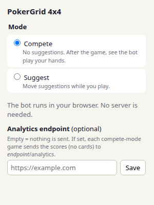
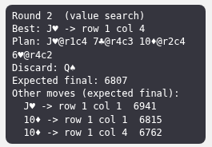
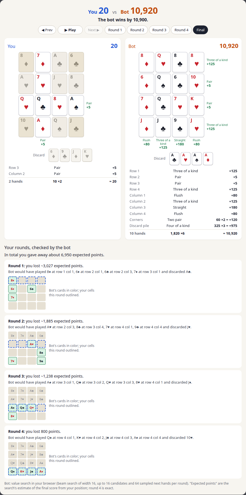
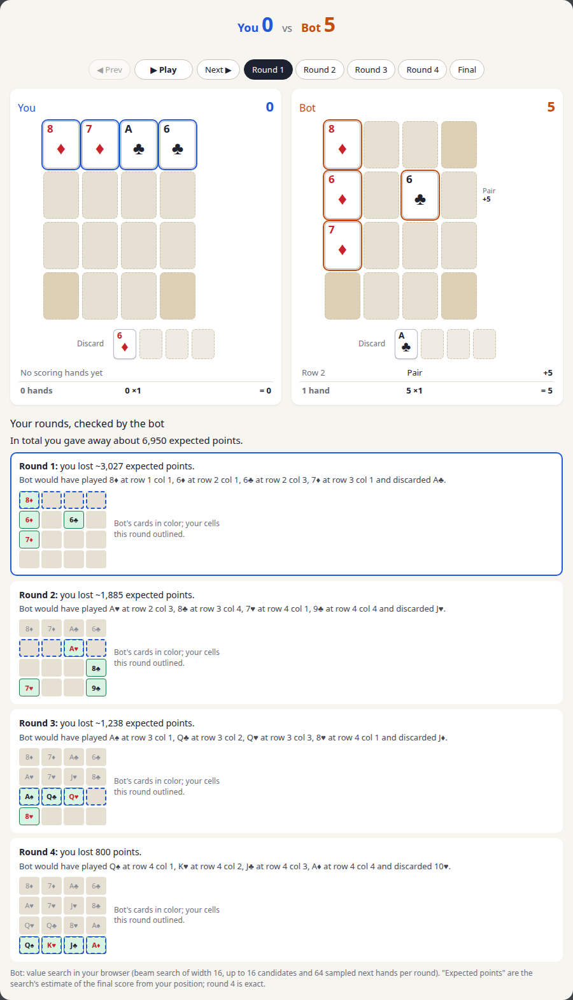
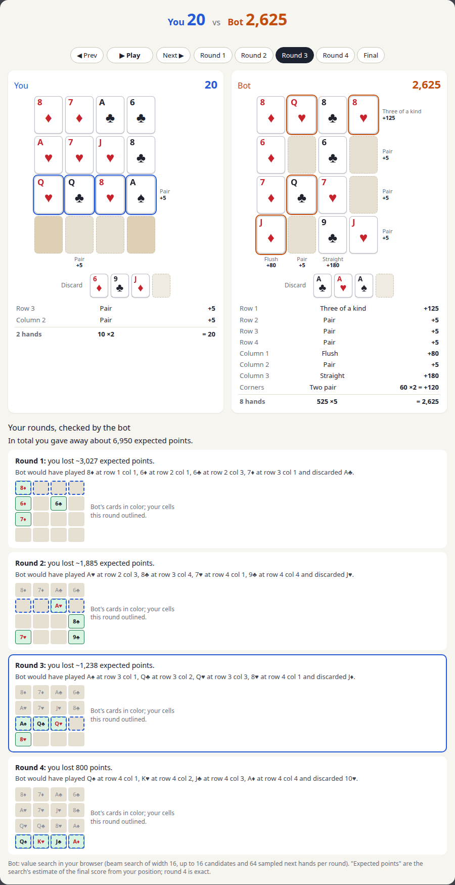
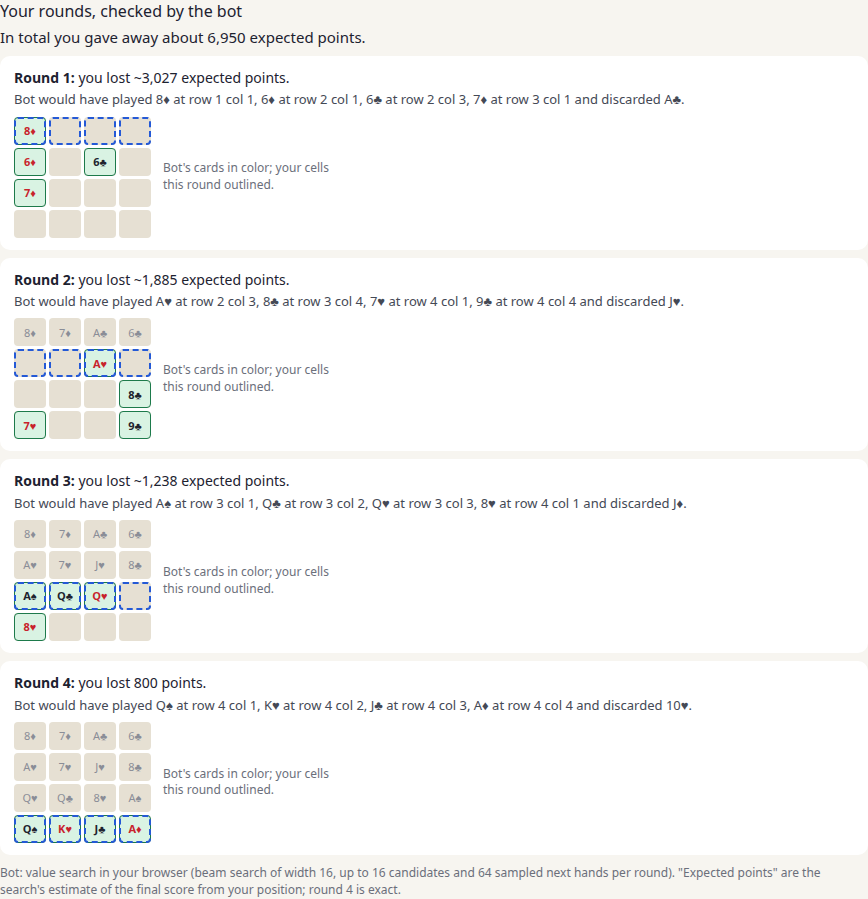

# PokerGrid 4x4 (Chrome extension)

PokerGrid 4x4 is a Chrome extension for [Pile-Up Poker on Puzzmo](https://www.puzzmo.com/game/pile-up-poker) with two modes, chosen in its popup (click the extension icon):

- **Compete** (default): no help while you play. When you finish, the bot plays the same 4 hands, and a "You vs Bot" replay opens on top of the game, with a check of each of your rounds.
- **Suggest**: move suggestions while you play: the plan for the rest of the round, the discard card and the expected final score.

The bot is the cheap value search ([algorithm](algorithm.md)). It scores about 6,860 on the 1000-deck benchmark, the same as the full value search within noise ([browser port](value-search.md#browser-port)). It runs inside the extension in JavaScript and WebAssembly: no server, no Python, no GPU. A bot game with the analysis takes about 0.25 s on a desktop CPU.

The extension never plays for you. It reads only the board, the hand and the discard pile, never the face-down draw pile. It collects no data and sends nothing over the network by default ([privacy policy](privacy.md)). It is not affiliated with or endorsed by Puzzmo.



## Install

1. Get the extension folder: either `chrome_extension/extension/` from this repository, or a zip built by `python chrome_extension/package.py` (unzip it into a new folder; `manifest.json` is at the root of the zip, as the Chrome Web Store requires).
2. Open `chrome://extensions` and turn on **Developer mode** (top right).
3. Click **Load unpacked** and select the folder that contains `manifest.json`.
4. Click the extension icon (pin it from the puzzle-piece menu) to choose the mode.
5. Open https://www.puzzmo.com/game/pile-up-poker and start the game.

It works in Chrome, Edge, Brave and other Chromium browsers, version 111 or later. Only the normal 4x4 game is supported; other game modes (5x5, Fantasy Land, Moon) show a note instead.

## Suggest mode

A panel at the top right of the board shows the suggestion, and the suggested card and cell get a pink outline:

- `Best`: the card to play and its cell (row 1 = top row on screen, col 1 = left column).
- `Plan`: the bot's placements for the rest of the round. Their order does not matter.
- `Discard`: the card the plan leaves for the discard pile. Play the other cards and press "Next round", or move the discard card to the discard pile first: both work.
- `Expected final`: the search's estimate of the final total score.
- `Other moves (expected final)`: the best moves outside the plan, each with the value network's estimate of the final score after that single move (no search). The `Expected final` of the plan also checks the sampled next hands, so the two numbers are not directly comparable.

The round is planned once when the hand is dealt (about 0.1 s in round 1, less later); following the plan needs no new search. You can always play something else: if you place a card elsewhere or discard another card early, the rest of the round is planned again with your choices fixed.



## Compete mode

1. Play a normal game. The extension records each hand when it is dealt.
2. When all 16 cards are placed and the 4th card is on the discard pile, an overlay shows "Bot is playing your hands..." for a moment, then the replay. "Close" (or Esc) returns to the game. If the search fails, the overlay shows the error and a "Try again" button.

The bot plays your 4 hands; in round r it knows only hands 1 to r. Then, for each of your rounds, the search compares your decision with its own choice from your position, on the same sampled next hands. The difference is the expected points you lost in that round; round 4 is exact. Details: [algorithm, compete mode](algorithm.md#6-compete-mode-the-bots-game-and-the-analysis). Next hands come from a seeded random number generator, so the same game always gets the same answer.



### The replay

`extension/replay/replay.js` and `replay.css` (plain JavaScript and CSS, no framework, no external assets). `PPReplay.render(container, data, options)` draws a bot game answer (see [Replay data](#replay-data)):

- Header: the two totals, and at the final step who won and by how much.
- Stepper: Prev / Play-Pause / Next and the steps Round 1-4 and Final (arrow keys work too). It plays by itself at the start. New cards slide into their cells; the cards of the shown round have a colored outline. Scores count up.
- Two boards side by side (stacked on narrow screens) with the discard piles. Each row and column shows its hand and points. Below each board a list gives every scoring hand ("Straight +180", "Corners: Straight 180 x2 = +360", "Discard pile: Three of a kind 125 x3 = +375") and "sum x multiplier = total". At the final step the cards outside every scoring hand are grayed out, and hovering a hand in the list highlights its cells.
- Analysis: one entry per round ("Round 2: you lost ~1,235 expected points" or "you played the bot's choice"), the bot's choice from your position, and a mini board with the bot's cards in color and your cells of that round outlined. Clicking an entry shows that round.
- Options: `step` (start step 0-4), `autoplay`, `interval` (ms per step), `reducedMotion`. Animations are also off when the system asks for reduced motion (`prefers-reduced-motion`).

Hand names and points come from `policy.js` (`PPPolicy.scoreBreakdown`, the same scoring as `jax_env.calculate_total_score`), so `policy.js` must be loaded first. The component does not use any extension API.

| Round 1 | Round 3 | Analysis |
|---|---|---|
|  |  |  |

To see the replay without Puzzmo, serve the folder and open `replay_demo.html`; it shows `replay_sample.json`, and `replay_demo.html?data=other.json` loads another answer:

```bash
python -m http.server 8000 -d chrome_extension   # then open http://localhost:8000/replay_demo.html
```

### Replay data

`PPAssistant.botGame(nets, req)` (`assistant.js`) takes the finished game:

```json
{"hands": [["H-12", "D-1", "S-7", "S-11", "D-10"], "... 4 hands of 5 cards as dealt"],
 "board": ["... the player's final 16 cards, row-major, top row first"],
 "discard": ["... the player's 4 discards (optional; checked if given)"]}
```

Cards are Puzzmo ids (`"H-12"` = queen of hearts, ace = 1) or names (`"QH"`, `"TS"`). A board card belongs to the round of its hand, so the hands and the final board give every round's 4 placements and discard. The answer (cards as names, cells 0-15 row-major, top row first; `chrome_extension/replay_sample.json` is a full example):

```json
{"hands": [["QH", "AD", "7S", "JS", "TD"], "..."],
 "settings": {"model": "value_search", "where": "browser", "num_candidates": 16, "num_samples": 64, "beam_width": 16, "...": "..."},
 "player": {"rounds": [{"placements": [{"card": "7S", "cell": 1}, "... 4"], "discard": "AD", "score": 0}, "... 4 rounds"],
            "final_score": 600},
 "bot": {"rounds": ["... same format"], "final_score": 7050},
 "analysis": {"rounds": [{"round": 1, "bot_choice": {"placements": ["..."], "discard": "QD", "score": 360},
                          "bot_value": 6100.3, "player_value": 5741.8, "loss": 358.5, "same_as_bot": false}, "... 4 rounds"],
              "total_loss": 358.5}}
```

`score` is the score after the round (partial rows and columns count pairs and three of a kind, as in the game). `loss = bot_value - player_value` in expected final points; `total_loss` is the sum of the positive losses. `same_as_bot` means the same placements and discard (the loss is then 0).

## Analytics

The popup has an optional **analytics endpoint** field. It is empty by default, and then nothing is sent over the network. When you enter a URL and click Save, Chrome asks for permission to send to that origin (`optional_host_permissions`). After that, at the end of each compete-mode game, the service worker sends one request:

```
POST {endpoint}/analytics
Content-Type: application/json

{"version": "1.3.0", "player_score": 600, "bot_score": 7050, "total_loss": 6912.4}
```

- `version`: the extension version (from `manifest.json`).
- `player_score`, `bot_score`: the final scores of your game and of the bot's game.
- `total_loss`: the analysis's total expected points lost.

Trailing slashes of the endpoint are removed before `/analytics` is added. No cards, no game state and no personal data are sent. The answer is not read, and a failed request is ignored. Suggest mode never sends anything. The [privacy policy](privacy.md) describes the same. The receiver is not part of this repository; any HTTP endpoint that accepts this POST works. The live compete-mode test checks the request with a small receiver of its own (`verify_live_compete.py --analytics`).

## How it works

- `content.js` runs in the game's iframe (`https://www.puzzmo.com/runtime.html*`) in the page's JavaScript world, because the game state (its Redux store) is only reachable from there. It finds the store through the React internals of a card element and reads only the board, the hand, the discard pile and the round. A Puzzmo update can break this; the panel then stays empty. It draws the suggestion panel, or records the hands and opens the replay overlay.
- An early discard (select a card, then click the discard pile) is reported as `discarded_this_round`, and the plan never uses that card.
- The search runs in the **service worker** (`background.js`), not on the page's main thread, so the game stays responsive. The page world cannot use `chrome.*` APIs, so `bridge.js` (a content script in the isolated world) relays `suggest` and `bot_game` requests between `content.js` (`window.postMessage`) and the service worker (`chrome.runtime.sendMessage`). It also passes the mode setting to `content.js`.
- The service worker loads `policy.js`, `search.js` and `assistant.js` with `importScripts`, and at start-up the WebAssembly kernel and the two networks (1.8 MB, from the extension package). Answers to old suggest requests (the position changed meanwhile) are dropped.
- Permissions: `storage` (the settings) and, only if you set an analytics endpoint, that endpoint's origin. The manifest allows WebAssembly in extension pages (`content_security_policy`: `script-src 'self' 'wasm-unsafe-eval'`).

## Development

Files in `chrome_extension/`:

- `extension/`: the extension itself (this folder is what gets zipped).
  - `manifest.json`: Manifest V3. The main content script runs in the page's world (`"world": "MAIN"`), `bridge.js` in the isolated world.
  - `search.js`: the cheap value search (`PPSearch`): afterstate features, the MLP value, beam search, successive halving, the card-by-card inner policy, the exact last round, sampling of next hands.
  - `mlp.wasm` (2 KB): the MLP layers as WebAssembly SIMD kernels, built from `wasm/src/lib.rs` by `build_wasm.py`.
  - `nets/`: the two networks as float32, `value.bin` (512-wide afterstate MLP, 1.5 MB) and `inner.bin` (128-wide, 190 KB), with `nets.json` (layer sizes, value scale).
  - `assistant.js`: `botGame(nets, req)` (compete mode) and `suggest(nets, req)` (suggest mode) on top of `search.js`.
  - `policy.js`: the game rules (`PPPolicy`): card names, the state from the visible cards (`buildState`), the action mask, and scoring with a breakdown (`scoreBreakdown`).
  - `content.js`, `bridge.js`, `background.js`, `popup.html`, `popup.js`, `replay/`, `icons/`.
- `export_weights.py`: writes `extension/nets/` from `models/afterstate_mlp` and `models/td_h128` (see [Models](../README.md#models)).
- `build_wasm.py`, `wasm/`: the Rust source of `mlp.wasm` (needs `rustup target add wasm32-unknown-unknown`).
- `test_search_parity.py` + `test_search.js`: parity of the JS search with JAX.
- `test_assistant.js`: bot games and suggest-mode games in Node.
- `bench_search.js`: the 1000-deck benchmark in Node (`worker_threads`); `bench_decks.py` writes the decks. `bench_browser.py`: timings in the extension's service worker.
- `node_nets.js`: loads the networks in Node.
- `verify_live_extension.py`, `verify_live_compete.py`, `live_helpers.py`: live tests on puzzmo.com.
- `replay_demo.html`, `replay_sample.json`: the replay without Puzzmo.
- `package.py`: builds `chrome_extension/dist/pokergrid-4x4-<version>.zip` (`manifest.json` at the zip root, as the Chrome Web Store requires).
- `store/`: the Chrome Web Store listing text and privacy answers (`listing.md`) and the media, each with the script that renders it: the store images and the store icon (`images/`, `make_store_images.py` from `replay_demo.html`, `sample_game.json`, `popup_scene.html`, `promo_tile.html`), the extension icons (`make_icons.py`), and the README animation `docs/images/greedy_vs_value_search.gif` (`make_readme_gif.py` from `readme_scene.html` and `greedy_vs_bot.json`, a greedy game and the bot's game on deck 18 of the benchmark).

The Python scripts run in the project environment, the Node tests with Node 22. The browser scripts need Playwright, kept in a separate environment so the project environment stays small:

```bash
uv venv .tools-venv
uv pip install --python .tools-venv/bin/python playwright
.tools-venv/bin/playwright install chromium
```

Commands, from the repo root:

```bash
python chrome_extension/export_weights.py           # after retraining a network
python chrome_extension/build_wasm.py               # after changing wasm/src/lib.rs
JAX_PLATFORMS=cpu python -m chrome_extension.test_search_parity   # JAX reference cases -> /tmp/pp_search_cases.json
node chrome_extension/test_search.js
python -m chrome_extension.bench_decks              # benchmark decks -> /tmp/pp_decks.json
node chrome_extension/test_assistant.js
node chrome_extension/bench_search.js --decks 1000 --seed 0
.tools-venv/bin/python -m chrome_extension.bench_browser
.tools-venv/bin/python -m chrome_extension.verify_live_extension
.tools-venv/bin/python -m chrome_extension.verify_live_compete [--analytics]
python chrome_extension/package.py
```

The live tests open the game as a guest in headless Chrome for Testing with the unpacked extension and click in the game (for the test only; the extension itself never clicks). They score the final board with `jax_env` through the project environment at `.venv/bin/python`. `verify_live_compete.py` writes the replay screenshots of this page to `docs/images/`; other screenshots go to `logs/verify_live/`.

## Tests

- `test_search.js`: features, scores and values match JAX, and the search makes the same decisions as JAX with the same sampled next hands. It also checks `policy.js`'s scoring. Numbers: [browser port, parity](value-search.md#parity-with-jax).
- `test_assistant.js` (10 decks): the bot's final score equals the score of its board; the player's score equals the score of the player's board; a player who copies the bot's game loses 0 in every round; suggest-mode games that follow the panel (with an early discard in round 2 and a deviation from the plan in round 3) are legal and end with the panel's final score.
- `verify_live_extension.py` (suggest mode, live, Oct 2026, headless Chrome for Testing 153): full games that follow the panel, with an early discard in round 2. Every suggested move was legal, and the game's total score equaled jax_env's score of the final board in three games (10920, 4875 and 7020; the last one with version 1.3.0).
- `verify_live_compete.py` (compete mode, live, same browser): it plays the first legal moves, so the player's scores are low. In three games no suggestion appeared, the replay opened after "Finish" with both boards (16 cards each), the replay's player score equaled the game's total score and jax_env's score (120, 30 and 0), the bot's final score equaled the JS scoring of its board (1975, 7800 and 7800), and no request went to a local server. The bot game took 263-278 ms in the service worker (761 ms in the last game, while other jobs were using the CPU). Two games ran with `--analytics` (the second with version 1.3.0): the receiver got exactly one request with the version and the game's scores.
