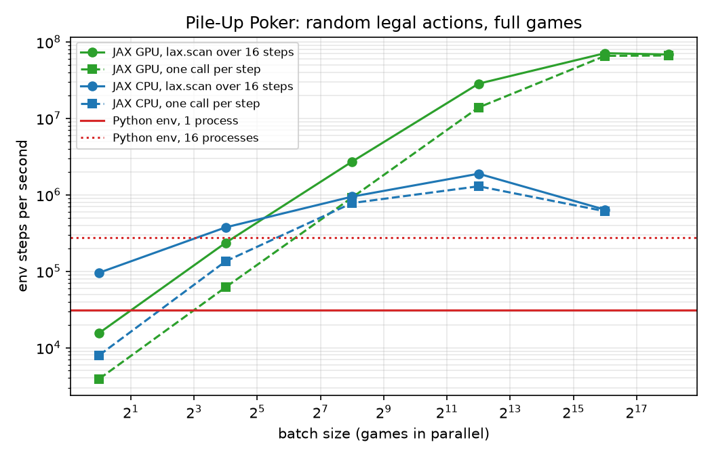

# JAX port of the environment

> The JAX port of Pile-Up Poker follows the methodology of [Automatic Generation of High-Performance RL Environments](https://arxiv.org/abs/2603.12145) (Seth Karten, Rahul Dev Appapogu, Chi Jin; arXiv:2603.12145, 2026). Rahul Dev Appapogu, the author of this repository, is a co-author of the paper. BibTeX is at the [end of this page](#citation).

The game was first written as a Python/Gymnasium environment (`pileup_poker/pileup_poker.py`). It was then ported to a batched JAX environment (`pileup_poker/jax_env.py`). All training and evaluation code in this repo uses the JAX version. This page explains the port, shows that both environments give the same games, and measures the speedup.

Main results (RTX 3090, Ryzen 7 7700X; all numbers measured with the scripts in `benchmarks/`):

- **Same games.** In 1000 games with random actions (including 3,006 illegal actions), both environments give identical observations, action masks, rewards, done flags and final scores at every step. Policies trained in the JAX env get exactly the same scores in the original Python env (1000 decks, paired difference 0).
- **Environment speed.** Random full games: **4,447,017 games/s** (71M steps/s) with the JAX env on the GPU (batch 65,536), versus 1,938 games/s for the Python env in one process: **2,295x**. Against the Python env in 16 processes (17,104 games/s) it is 260x.
- **Greedy agent.** 323 games/s with the JAX greedy on the GPU versus 0.80 games/s with the Python greedy: **402x**, with identical scores.
- **PPO training.** 182,001 env steps/s with the JAX env on the GPU (1024 envs) versus 20,007 steps/s with the Gym env (best Gym setting measured): **9.1x** end to end.

## Method

The paper describes a closed-loop way to translate a reference environment into a fast one: a generic prompt template, iterative repair, and hierarchical verification. The verification has four levels:

1. **L1, property and component tests**: single components, for example the scoring rules.
2. **L2, interaction tests**: several modules composed.
3. **L3, rollout comparison**: full episodes in both environments with matched seeds and identical actions; observations, rewards and terminations are compared at every step.
4. **L4, cross-backend policy transfer**: a policy trained in the fast environment is evaluated in the reference environment. The reward gap must not be statistically significant, that is, there is no sim-to-sim gap.

The paper also profiles PPO training to show that training moves from being bound by the environment to being bound by the model. This page follows the same structure: [what was ported](#how-the-port-works), [verification L1 to L4](#verification), [environment speed](#environment-speed), and [training time](#end-to-end-training).

## Why JAX

The Python env handles one game. Each step runs Python code: lists of card strings, a Python scoring function with loops over rows and columns, and a new dict of NumPy arrays for the observation. A training loop with many games calls it once per game per step, and the network has to wait for the Python loop.

The JAX env works on arrays for a whole batch of games:

- **Batched:** one call steps all games. The batch size is only limited by memory.
- **Compiled:** `jax.jit` compiles `step`, the mask, the observation and the scoring to XLA once per batch shape.
- **On the device:** game states stay on the GPU next to the network, so observations do not have to be copied from the CPU to the GPU every step.
- **No Python loop per game or per step:** whole games run inside `jax.lax.scan`, and search (mctx) and self-play run inside one compiled function.

## How the port works

- **State as arrays.** `EnvState` is a named tuple of arrays with a leading batch dimension: `deck (B, 36)` draw order, `grid (B, 16)` card ids or -1, `used (B, 36)`, `current_round`, `num_moves`, `discard (B, 4)`, `done`. Card id = `rank * 4 + suit`, the same order as `DECK` in the Python env. Hand `r` is `deck[:, 5r:5r+5]`, so the Python env's `pop` of 5 cards per round becomes an index.
- **Vectorized scoring.** `_generic_hand_score` scores one 4-card line with array operations: rank counts from a 4x4 equality matrix, the number of distinct ranks, a flush test on suits and a straight test on sorted ranks. It follows the branch order of the Python `get_hand_score` (distinct ranks first, then straight flush, flush, straight). Partial lines (2 or 3 cards) use `_partial_pair_or_trip_score`. `calculate_total_score` scores 4 rows, 4 columns, the corners (x2) and the discard pile (x3 only if the first 9 hands score), applies the multiplier and is `vmap`ped over the batch.
- **Action masking.** `get_action_mask` is the outer product of "hand card not used yet" (5) and "cell empty" (16), giving the same `slot * 16 + cell` encoding as the Gym env's `Discrete(80)`. Finished games get an all-false mask.
- **Auto-correction.** As in the Gym env with `enforce_valid_actions=True`, an illegal action is replaced by the first legal action (`argmax` of the mask in JAX, `valid_indices[0]` in Python).
- **End of round.** After the 4th placement the unused hand card is written to `discard[:, round]`, and the round counter moves on. All of this uses `jnp.where` masks, so games in different rounds can share one batch.
- **Auto-reset.** `reset_done(state, done, key)` replaces finished games with new shuffled decks, so a training batch never stops.
- **Determinize.** `determinize(state, key)` shuffles only the undealt cards, so search agents never see the real future draws (see [symmetries and determinization](symmetries-and-determinization.md)).
- **Reward.** The JAX env returns 0 for non-terminal moves and the final score for the last move. The Gym env returns `1 + current board score` for non-terminal moves and the same final score for the last move. The training scripts compute their own shaped reward (see [environment](environment.md#reward-used-for-training)), so only the final score matters. The parity test below compares the Gym reward with `1 + calculate_total_score` of the JAX state.

## Verification

### L1: scoring rules

`benchmarks/scoring_tests.py` compares three scorers: the Python env's `_calculate_score`, `jax_env.calculate_total_score`, and a small reference scorer written from the rules in [environment.md](environment.md).

- **20/20 hand-picked boards** pass, with the expected score computed by hand: every hand type, ace-high-only straights (J Q K A scores, A 6 7 8 does not), partial lines, corners x2, the x2 multiplier for 2 hands, and a full board where all 9 hands score with three different discard piles (straight flush x3 and x6 = 27,420; pair x3 and x6 = 19,410; discard scores nothing, so 9 hands and x5 = 16,100).
- **200,000 random boards** (105,922 full, the rest partial; half drawn from 6 of the 9 ranks so that more hands score): the JAX and Python scores differ on **0** boards. Every multiplier from x1 to x6 occurs (x6 on 881 boards), and the discard pile scores on 881 boards.
- The reference scorer agrees with both on all full boards. It differs on 14 partial boards. In all of them the 8 lines and the corners score while the discard pile has only 2 or 3 cards. The original env scores this short discard pile with the 4-card rule, so a pair among 3 cards counts as two pairs (60 x3). The JAX env reproduces this exactly. It can only happen before the end of the game, so it never changes a final score. It does change the intermediate board score used by the greedy agent and by reward shaping in a few late-game positions.

### L2: interaction tests

There are no separate L2 tests. The composed path (mask, auto-correction, placement, end-of-round discard, scoring, observation) is exercised in every step of the L3 rollouts below. The greedy port is a second check of the composed path: `jax_greedy.play_greedy` reproduces the Python greedy's scores (see [greedy agent](#greedy-agent)).

### L3: rollout comparison

`benchmarks/env_speed.py parity` plays 1,000 games (16,000 steps) in both environments. Each game uses the same deck in both: the Gym env gets the first 20 cards with `set_deck`, and the JAX env gets the Gym env's resulting 36-card draw order. Actions are random legal actions, and each action is an illegal one (a random action in [0, 80) that the mask forbids) with probability 0.2. This gave 3,006 illegal actions, which both environments must correct in the same way. The Gym games are played first and their actions are replayed in one JAX batch.

At every step it compares the 796-dim observation (`flatten_observation` vs `build_observation`) and the action mask before the step, the reward and the done flag after it, and the observation and mask after the last step.

| compared | mismatching games/steps |
|---|---|
| observations (17,000) | 0 |
| action masks (17,000) | 0 |
| rewards (16,000) | 0 |
| done flags (16,000) | 0 |
| final scores (1,000) | 0 |

All values are equal (maximum absolute reward difference 0.0).

### L4: policy transfer

`benchmarks/policy_transfer.py` takes two agents trained only in the JAX env and plays them in the original Gym env, on the same 1000 decks as in the JAX env. In the Gym env the agents only get what the Gym env gives them: `flatten_observation(obs)` and `get_action_mask()`. The afterstate agent needs the board, hand and discard as card ids; they are decoded from the flattened observation.

| agent | JAX env, mean ± SE | Gym env, mean | paired difference | games with a different score |
|---|---|---|---|---|
| PPO attention (`ppo_cont_control`) | 6294.2 ± 67.4 | 6294.2 | 0.0 | 0 / 1000 |
| afterstate TD, MLP (`afterstate_mlp`) | 6132.8 ± 72.5 | 6132.8 | 0.0 | 0 / 1000 |

Both agents play deterministically (argmax), so the expected gap is exactly 0, and it is 0: there is no sim-to-sim gap. The greedy agent (not trained) also gets identical scores in both implementations, see below.

## Environment speed

`benchmarks/env_speed.py` plays full games (16 steps) with uniformly random legal actions. The work per step is the same in both environments: compute the action mask, pick a random legal action, step, and build the 796-dim observation.

- **Python env:** one process, games one after another for 10 s, 3 repetitions. Also 16 processes (`multiprocessing`, one env per process) to use all CPU threads.
- **JAX env, `lax.scan`:** one jitted function plays a whole batch of games: new decks, then a `lax.scan` over the 16 steps. Compile time is measured separately (0.7 to 0.9 s on the CPU, 1.2 to 1.5 s on the GPU per batch size) and is not included in the throughput.
- **JAX env, one call per step:** the same games, but a Python loop calls a jitted step function 16 times, as `train_jax_ppo.py` does.
- Each JAX measurement is 5 repetitions of about 1 s (enough calls to fill the second), each ended with `block_until_ready`. Tables show the median.

Python env: **1,938 games/s** (31,009 steps/s) in one process, 17,104 games/s with 16 processes.

JAX env, games/s (speedup over the Python env in one process):

| batch size | CPU, `lax.scan` | GPU, `lax.scan` | CPU, one call per step | GPU, one call per step |
|---|---|---|---|---|
| 1 | 5,985 (3.1x) | 975 (0.5x) | 498 (0.3x) | 245 (0.1x) |
| 16 | 23,436 (12.1x) | 14,735 (7.6x) | 8,439 (4.4x) | 3,865 (2.0x) |
| 256 | 59,156 (30.5x) | 169,926 (87.7x) | 48,748 (25.2x) | 57,661 (29.8x) |
| 4,096 | 117,817 (60.8x) | 1,775,020 (915.9x) | 80,699 (41.6x) | 867,142 (447.4x) |
| 65,536 | 39,837 (20.6x) | 4,447,017 (2,294.5x) | 38,061 (19.6x) | 4,100,260 (2,115.6x) |
| 262,144 | – | 4,276,433 (2,206.5x) | – | 4,149,098 (2,140.8x) |



What the numbers show:

- With one game at a time, the JAX env is not faster: on the GPU each call has a fixed cost (about 1 ms per game with `lax.scan`). The gain comes from the batch.
- On the GPU the throughput grows nearly in proportion to the batch size up to 4,096 and levels off at about 71M steps/s from batch 65,536.
- On the CPU the best batch is 4,096 (117,817 games/s, 61x one Python process and 6.9x 16 Python processes). At 65,536 it is slower again, probably because the arrays no longer fit in the CPU caches.
- Calling the step function from a Python loop costs up to half of the throughput at mid-size batches (GPU, batch 4,096: 867,142 vs 1,775,020 games/s). At large batches the difference is small.

### Greedy agent

The greedy agent scores every way to play a round (up to 218,400 candidate boards in round 1) and keeps the best. `pileup_poker/jax_greedy.py` is an exact port of `greedy_agent.py`; see [greedy](greedy.md).

| implementation | decks | games/s | first call (incl. compile) |
|---|---|---|---|
| Python `greedy_agent.py` | 100 | 0.80 | – |
| JAX, CPU | 100 | 13.3 (17x) | 11.8 s |
| JAX, GPU | 1,024 | 323 (402x) | 9.9 s |

On the first 100 decks, all three give identical scores for every game (mean 3052.65). The JAX greedy uses its default `lax.map` batch size of 8 games.

## End-to-end training

### PPO throughput

`benchmarks/ppo_speed.py` runs `train_jax_ppo.py` for a few updates and timestamps each `[update k/n]` log line. Steps/s are measured over the updates after 3 warm-up updates, so compile time is not included. All runs use the default MLP (256 hidden units, joint action head), 64 steps per env per update, 4 epochs x 8 minibatches, no evaluation. The Gym backend requires `--no-reward-shaping`; the 1024-env JAX runs use the normal settings of `ppo_mlp_long` (reward shaping, `--gamma 1.0`). "Network" is the device that JAX uses for the policy and the update.

| env | network | envs | reward shaping | measured updates | warm-up (s) | env steps/s |
|---|---|---|---|---|---|---|
| Gym (Python) | CPU | 64 | no | 10 | 3.3 | **14,949** |
| Gym (Python) | GPU | 64 | no | 10 | 8.9 | **10,914** |
| JAX | CPU | 64 | no | 20 | 4.2 | **22,431** |
| JAX | GPU | 64 | no | 20 | 9.7 | **11,897** |
| Gym (Python) | CPU | 1,024 | no | 3 | 12.2 | **20,007** |
| JAX | CPU | 1,024 | yes, gamma 1.0 | 5 | 7.5 | **57,890** |
| JAX | GPU | 1,024 | yes, gamma 1.0 | 20 | 13.2 | **182,001** |

- With 64 envs, the JAX env gives only 1.5x (CPU) or less: one PPO update has a fixed cost (64 rollout steps, 32 minibatch updates) that does not depend on the number of envs, and with 64 envs this fixed cost dominates.
- The JAX env lets the batch grow at almost no cost: going from 64 to 1024 envs on the GPU raises the throughput 15x. With the Gym env the cost grows with the number of envs: 1024 envs give only 1.3x more steps/s than 64.
- Best measured settings: **182,001 steps/s** (JAX, GPU, 1024 envs) versus **20,007 steps/s** (Gym, CPU, 1024 envs): **9.1x**.

### Where the time goes

`benchmarks/ppo_breakdown.py` re-creates one PPO iteration of `train_jax_ppo.py` (MLP, no reward shaping, 64 steps, 4 x 8 minibatches) with a timer around each phase. Each phase ends with `block_until_ready`, so the split is exact but a little slower than the real loop. Mean seconds per iteration over 5 iterations (3 for Gym with 1024 envs) after 2 warm-up iterations:

| setting | envs | env stepping | policy inference | PPO update | total (s) | steps/s |
|---|---|---|---|---|---|---|
| Gym, network on CPU | 1,024 | 2.298 (71%) | 0.096 (3%) | 0.856 (26%) | 3.250 | 20,167 |
| Gym, network on CPU | 64 | 0.147 (54%) | 0.029 (10%) | 0.099 (36%) | 0.275 | 14,904 |
| Gym, network on GPU | 64 | 0.167 (46%) | 0.017 (5%) | 0.183 (50%) | 0.367 | 11,150 |
| JAX, GPU | 64 | 0.145 (43%) | 0.016 (5%) | 0.180 (53%) | 0.341 | 12,001 |
| JAX, GPU | 1,024 | 0.147 (43%) | 0.018 (5%) | 0.176 (52%) | 0.341 | 192,214 |

- With the Gym env and 1024 envs, **71%** of the time is spent in the environment (35.9 ms per step for 1024 games).
- With the JAX env on the GPU, the environment phase takes 2.3 ms per step, the same for 64 and 1024 envs (16x less than the Gym env at 1024 envs). It is still 43% of the iteration, but this is the fixed cost of the Python loop in `train_jax_ppo.py` (several small jitted calls and host copies per step), not game simulation: run inside one `lax.scan` call, the same env does 28M steps/s at batch 4,096 (see [environment speed](#environment-speed)). With 64 envs the JAX env phase is no faster than the Gym env phase (0.145 s vs 0.147 s), for the same reason. Training is now bound by these fixed per-step and per-update costs and by the model, not by the game.

### What this made possible

These are the long runs reported in this repo (times from their logs, one RTX 3090 shared by several runs):

- **PPO MLP:** 300M steps in 1.1 h (`ppo_mlp_long`, about 78k steps/s overall). **PPO attention + BC:** 200M steps in 2.6 h.
- **Afterstate TD:** 10.2M (MLP) and 15.4M (n-tuple) self-play games in 55 min each, with all 80 afterstates of every move scored.
- **AlphaZero-style agent:** 909k self-play games with 64 mctx simulations per move in 2.6 h. Every simulation calls `jax_env.step` inside the compiled search, which only works because the env is a JAX function.

Extrapolations (computed from measured rates, not measured runs):

- `ppo_mlp_long` first reached an evaluation score above 4,000 at 91.8M steps (evaluation 4117.8 at update 1400 of its training log), about 24 min into the run. At the best measured Gym rate (20,007 steps/s) the same number of steps would take about 76 min, and the full 300M steps about 4.2 h instead of 1.1 h. At the JAX rate measured here (182,001 steps/s, GPU not shared) it would take about 8 min.
- The AlphaZero run's search did about 931M environment steps (909k games x 16 moves x 64 simulations). At the Python env's single-process rate (31,009 steps/s) the environment steps alone would take about 8.3 h, about 0.9 h with 16 processes, before any network or tree search work, which would also have to move to Python.

## Setup and reproduction

Hardware and software: AMD Ryzen 7 7700X 8-Core Processor (8 cores, 16 threads), 30 GB RAM, NVIDIA GeForce RTX 3090 (24 GB, driver 595.84), Python 3.12.3, jax 0.11.2, jaxlib 0.11.2, NumPy 2.5.4, Gymnasium 1.4.0. Another process used about 3 GB of GPU memory and a little GPU time during the runs. The benchmarks ran one after another, not at the same time. Raw results (JSON, with the system info) are in `benchmarks/results/`. All runs: October 2026, about 20 minutes in total.

From the repo root, with the environment activated (see the [README](../README.md#install)):

```bash
export XLA_PYTHON_CLIENT_PREALLOCATE=false
# L1, L3, L4
JAX_PLATFORMS=cpu python benchmarks/scoring_tests.py --random-boards 200000
JAX_PLATFORMS=cpu python benchmarks/env_speed.py parity --games 1000
python benchmarks/policy_transfer.py --games 1000   # needs models/ppo_cont_control and models/afterstate_mlp
# environment speed
python benchmarks/env_speed.py python-env
JAX_PLATFORMS=cpu python benchmarks/env_speed.py jax-env
python benchmarks/env_speed.py jax-env --batch-sizes 1 16 256 4096 65536 262144
# greedy (jax-greedy compares with python_greedy.json when the seed matches)
JAX_PLATFORMS=cpu python benchmarks/env_speed.py python-greedy --games 100
JAX_PLATFORMS=cpu python benchmarks/env_speed.py jax-greedy --games 100
python benchmarks/env_speed.py jax-greedy --games 1024
# PPO
python benchmarks/ppo_speed.py
JAX_PLATFORMS=cpu python benchmarks/ppo_breakdown.py --backend gym --num-envs 1024 --iterations 3
JAX_PLATFORMS=cpu python benchmarks/ppo_breakdown.py --backend gym --num-envs 64
python benchmarks/ppo_breakdown.py --backend gym --num-envs 64
python benchmarks/ppo_breakdown.py --backend jax --num-envs 64
python benchmarks/ppo_breakdown.py --backend jax --num-envs 1024
# plot (needs matplotlib: pip install matplotlib)
python benchmarks/plot_env_speed.py
```

## Citation

```bibtex
@article{karten2026automatic,
  title={Automatic Generation of High-Performance RL Environments},
  author={Karten, Seth and Appapogu, Rahul Dev and Jin, Chi},
  journal={arXiv preprint arXiv:2603.12145},
  year={2026}
}
```
